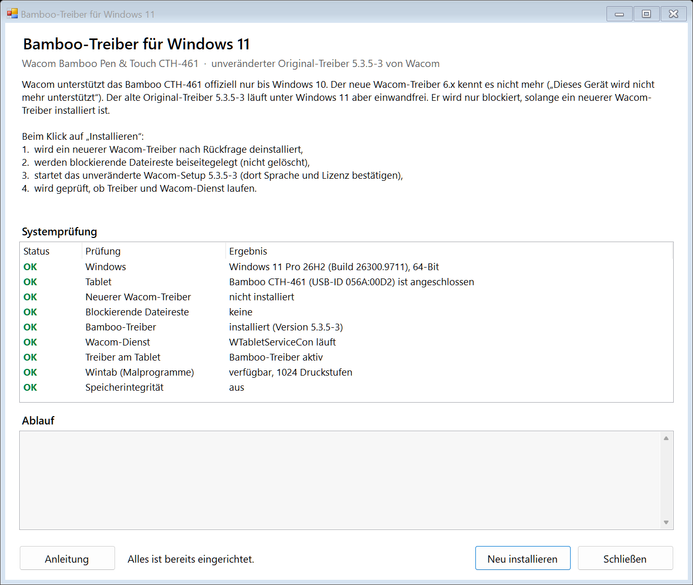

# Bamboo CTH-461 unter Windows 11

Installationshilfe für das **Wacom Bamboo Pen & Touch CTH-461** unter Windows 11. Sie installiert den unveränderten Original-Treiber **5.3.5-3** von Wacom. Vorher räumt sie aus dem Weg, was die Installation sonst still verhindert.



## Das Problem

- Wacom unterstützt das CTH-461 offiziell nur bis Windows 10. Der aktuelle Wacom-Treiber 6.x kennt das Tablet nicht mehr und meldet „Dieses Gerät wird nicht mehr unterstützt“.
- Der alte Treiber 5.3.5-3 läuft unter Windows 11 aber einwandfrei. Das Setup hat keine Windows-Versionssperre, und die Gerätetreiber sind von Microsoft signiert (WHQL).
- **Der Haken:** Ist ein neuerer Wacom-Treiber installiert (oder war es), überspringt das alte Setup Teile seiner Installation. Eine Fehlermeldung gibt es dabei nicht:
  - Liegt in `C:\Program Files\Tablet` eine neuere `wachidrouter.sys`, installiert es seinen Router-Treiber nicht. Das Bamboo bleibt dann ohne Funktion.
  - Liegt in `System32`/`SysWOW64` eine neuere `Wintab32.dll`, ersetzt es sie nicht. Die spricht aber nicht mit dem alten Dienst: Der Zeiger geht, der **Andruck in Malprogrammen** (Photoshop, GIMP, Krita im Wintab-Modus) fehlt.

## Was der Installer macht

1. **Systemprüfung:** Windows-Version, angeschlossenes Tablet, neuerer Wacom-Treiber, Dateireste, Bamboo-Treiber, Wacom-Dienst, Treiberbindung, Wintab-Schnittstelle und Speicherintegrität.
2. **Entfernt einen neueren Wacom-Treiber (6.x)** nach Rückfrage mit dessen eigenem Deinstallationsprogramm.
3. **Legt blockierende Dateireste beiseite.** Sie landen in `C:\Program Files\Tablet\_beiseitegelegt_<Datum>`, gelöscht wird nichts.
4. **Startet das unveränderte Wacom-Setup 5.3.5-3.**
5. **Prüft das Ergebnis:** Läuft der Dienst? Nutzt das Tablet den Bamboo-Treiber? Liefert Wintab Druckstufen? Dafür fragt er das Tablet so ab, wie ein Malprogramm es tut.

Ist der Bamboo-Treiber schon installiert, aber etwas stimmt nicht, bietet der Installer „Reparieren“ an. Der Wacom-Treiber selbst wird nicht verändert.

## Die exe bauen

Die fertige exe gibt es hier **nicht zum Download**. Sie enthält das Wacom-Treiberpaket, und dessen Lizenz verbietet die Weitergabe. Bauen geht aber mit einem Befehl, ohne zusätzliche Software, auf jedem Windows 10/11 (x64):

1. Bei Wacom (Support › Treiber) den Bamboo-Treiber **5.3.5-3 für Windows** herunterladen.
2. Das Paket entpacken. Es entsteht ein Ordner `pentablet_5.3.5-3` mit `setup.exe`, `Installer.dat` und `System32\`. Den Ordner ins Repository oder daneben legen.
3. Im Repository-Ordner ausführen:

   ```powershell
   powershell -ExecutionPolicy Bypass -File src\build.ps1
   ```

   Liegt der Treiberordner woanders, den Pfad mit `-Paket <Pfad>` angeben.

Das Ergebnis ist `Bamboo-Win11-Installer.exe` (ca. 38 MB). Das Skript prüft, ob es wirklich das Paket 5.3.5-3 ist. Übersetzt wird mit dem `csc.exe` des .NET Framework 4.x, der bei Windows dabei ist (Sprachstand C# 5).

## Benutzen

`Bamboo-Win11-Installer.exe` starten, Administratorrechte bestätigen und auf „Installieren“ klicken. Die ausführliche Anleitung mit Fehlerbehebung steht in [LIESMICH.txt](LIESMICH.txt). Sie ist auch in der exe enthalten (Knopf „Anleitung“).

Jeder Schritt wird nach `%TEMP%\Bamboo-Win11-Installer.log` protokolliert.

**Selbsttest ohne Systemänderung:** `Bamboo-Win11-Installer.exe /selftest <Ordner>` schreibt die Systemprüfung als Text, entpackt das Paket zur Kontrolle und speichert ein Bild des Fensters.

## Getestet

Auf Windows 11 Pro 26H2 (Build 26300) mit einem Bamboo CTH-461 (USB-ID `056A:00D2`):

| Ausgangslage | Ergebnis |
|---|---|
| Wacom 6.4.15 und Bamboo 5.3.5-3 gleichzeitig installiert | Die exe entfernt 6.4.15, legt 12 Treiberdateien beiseite und installiert 5.3.5-3. Das Tablet funktioniert. |
| Bamboo installiert, aber `Wintab32.dll` 1.0.5-10 von 6.x übrig | „Reparieren“ legt die DLLs beiseite. Danach meldet Wintab 1024 Druckstufen (64 und 32 Bit). |
| Nur Wacom 6.4.15 installiert | Die gleichen Schritte, von Hand ausgeführt, waren erfolgreich. |

Die Kernel-Treiber (`wachidrouter.sys`, `wacomrouterfilter.sys`, Version 3.2.1.1 von 2014) luden ohne Code-Integrity-Blockierung. Die Speicherintegrität (HVCI) war dabei ausgeschaltet. Ist sie eingeschaltet, kann Windows die alten Treiber blockieren. Die Systemprüfung warnt in diesem Fall.

## Lizenz und Haftung

- Der Code und die Dokumentation in diesem Repository stehen unter der [MIT-Lizenz](LICENSE).
- Der Wacom-Treiber ist **nicht enthalten**. Für ihn gilt der Wacom-Lizenzvertrag. Selbst gebaute exe-Dateien enthalten das Wacom-Paket und sollten deshalb nicht öffentlich weitergegeben werden.
- Dieses Projekt steht in keiner Verbindung zu Wacom. Wacom und Bamboo sind Marken der Wacom Co., Ltd. Die Benutzung geschieht auf eigene Verantwortung.
